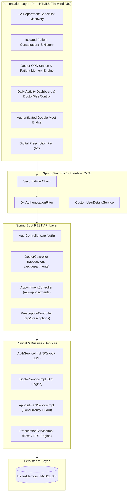

# 🏥 MediCare — Super Specialty Hospital Information & OPD System

[](https://www.oracle.com/java/)
[](https://spring.io/projects/spring-boot)
[](https://spring.io/projects/spring-security)
[](https://itextpdf.com/)
[](https://tailwindcss.com/)
[](LICENSE)

An enterprise-grade Healthcare Hospital Management & Smart OPD System built with **Java 17 LTS**, **Spring Boot 3.2**, **Spring Data JPA**, **Spring Security 6** (stateless JWT), **iText 7**, and a responsive **Tailwind CSS/JavaScript** frontend.

Engineered as part of the **Industrial Training & Final Project (Subject Code: NBCA 308P)** at **City College of Management, Lucknow**, by **Tanupriya Rai** under the supervision of **Mr. Danish Khan**.

---

## 🌟 Key Engineering Features & Recent Upgrades

### 1. 🩺 Doctor OPD Station with Authentication & Patient Memory Engine
- **Strict Role-Based Console Access**: Doctors authenticate into dedicated OPD consoles (`Dr. Priya Sharma`, `Dr. Rajesh Verma`, etc.) and view **strictly their own patient queue**, eliminating cross-doctor data leaks.
- **Dynamic Digital Prescription Pad (Rx)**: Doctors can prescribe medication rows on the fly (Medicine Name, Dosage, Frequency e.g., `1-0-1 After Food`, Duration, Instructions) and finalize diagnoses, transitioning appointment states to `COMPLETED`.
- **Longitudinal Patient Memory**: The system checks if a patient is a returning visitor (`Visit #2+`). Prominently triggers a **`Returning Patient Memory Alert`**, surfaces past diagnoses and chronic conditions, and provides a one-click **"Past Medical History"** viewer detailing previous prescriptions and allergies.

### 2. 🛡️ Admin Doctor Management, Pricing Control & Consultation Invoices
- **Doctor Onboarding**: Administrators can register new specialists specifying Full Name, Specialty, Qualification, OPD Room Number, Experience, and Base Consultation Fee (₹).
- **Dynamic Consultation Fee Controller**: Admin can adjust any doctor's fee dynamically via inline controls, instantly propagating changes across the booking catalog.
- **Official Hospital Tax Invoices**: Generates NABH-accredited hospital consultation invoices featuring GSTIN, SAC Code `999312` (Healthcare Services), itemized consultation charges + hospital sanitization fees, and one-click printable receipts (`window.print()`).

### 3. 🏥 Comprehensive 12 Medical Specialties & Departments
Expanded from basic departments to 12 clinical hospital divisions with dedicated specialty icons:
1. **Cardiology** (Heart & Vascular Intervention)
2. **Orthopedics** (Joint Replacements, Spine & Sports Trauma)
3. **Pediatrics** (Child Health & Neonatology)
4. **Neurology** (Brain, Spine & Neuro-Muscular Care)
5. **Dermatology** (Aesthetic & Clinical Skin Care)
6. **Gastroenterology** (Digestive Tract, Hepatology & Endoscopy)
7. **Oncology** (Cancer Care & Systemic Chemotherapy)
8. **Gynecology** (Obstetrics & Maternal-Fetal Health)
9. **Ophthalmology** (Eye Care, Cataracts & Laser Vision)
10. **ENT** (Ear, Nose & Throat Disorders)
11. **General Medicine** (Internal Medicine & Diabetology)
12. **All Specialties** (Master OPD Hospital Directory)

### 4. 🔒 Strict Patient Privacy Isolation ("My Consultations")
- Patient records are strictly isolated. Logged-in patients (e.g., `Tanupriya Rai` vs `Aarav Sharma`) view **only their personal consultation records, tele-health video links, and digital prescriptions**.

### 5. 💻 Online Tele-Consultation via Authenticated Google Meet Video Bridge
- **Dual-Mode Scheduling**: Patients select between **In-Person Hospital OPD** and **Online Video Tele-OPD**.
- **Doctor Room Code Sharing**: Attending doctors generate or customize verified **Google Meet room links/codes** (e.g., `meet.google.com/med-pya-shm`) and share them securely with the patient.
- **Patient Launch Station**: Patients access an authenticated video room card with camera/mic check simulators and one-click launch into the secure Google Meet session.

### 6. 📊 Real-Time Admin Daily Activity & Intelligence Dashboard
- **Key Daily Metrics**: Today's Consultations count, Completed (Rx finalized), In-Queue scheduled OPD, Revenue Collected (₹), and Video Tele-OPD ratio.
- **Department-Wise Distribution**: Live progress bars displaying footfall percentages across Cardiology, Orthopedics, Pediatrics, etc.
- **Real-Time Hospital Audit Feed**: Chronological stream logging bookings, payments, Google Meet links, fee adjustments, and prescriptions as they occur.

---

## 🏗️ System Architecture



---

## 🚀 Quick Start Guide

### 1. Instant Zero-Dependency Browser Demo (GitHub Pages Ready)
Open the standalone interactive client directly in your browser:
```
index.html (or double-click index.html in the repository root)
```
*No setup required! Seamlessly switch between Patient, Doctor, and Admin views with one click.*

### 2. Spring Boot Backend Server
```bash
cd C:/Users/KRIN/.gemini/antigravity/scratch/06-medicare-healthcare

# Run Spring Boot Application
mvn spring-boot:run
```
The application starts on `http://localhost:8081`.

---

## 🔑 Demo Login Credentials & Default Passwords

> [!IMPORTANT]
> **Role Isolation Demonstration**: Switch between Patient profiles (`Tanupriya Rai` vs `Aarav Sharma`) to verify private medical record isolation, or switch to Doctor logins (`Dr. Priya Sharma` vs `Dr. Rajesh Verma`) to inspect isolated departmental OPD queues.

| Role | Email / Login ID | Password | Portal View | Access Capabilities |
| :--- | :--- | :--- | :--- | :--- |
| **Hospital Administrator** | `admin@medicare.com` | `admin123` | Admin Panel | Add new doctors across 12 specialties, adjust consultation fees dynamically, view daily activity dashboard |
| **Doctor (Cardiology)** | `priya.sharma@medicare.com` | `doctor123` | Doctor Console | View Cardiology OPD queue, write digital Rx, share Google Meet code, access returning patient memory |
| **Doctor (Orthopedics)** | `rajesh.verma@medicare.com` | `doctor123` | Doctor Console | View Orthopedics OPD queue, authenticate video consultations |
| **Patient 1 (Primary)** | `tanupriya@medicare.com` | `patient123` | My Consultations | View personal bookings, join authenticated Google Meet video sessions, download hospital tax invoices |
| **Patient 2 (Secondary)** | `aarav.sharma@medicare.com` | `patient123` | My Consultations | Test strict medical record isolation (Aarav sees only his own records) |

---

## 💡 Key Technical Viva / Interview Q&A

1. **How does MediCare enforce patient data isolation between different patients?**
   * *Answer*: At the controller layer, Spring Security extracts the authenticated user's email from the JWT token via `Authentication.getName()`. The service queries `findByPatientUserEmailOrderByAppointmentDateDesc(email)`, ensuring patients can never query another patient's appointment records or prescriptions.
2. **How does the Patient Memory Engine work when a returning patient visits?**
   * *Answer*: The system executes a historical lookup on the `Patient` entity's `id`. If past appointment records exist (`countByPatient > 0`), the UI displays a `RETURNING PATIENT (Visit #2)` badge with an alert summary of chronic ailments, allergies, and prior diagnoses, allowing the attending physician to make informed clinical decisions.
3. **How does Google Meet video tele-consultation authentication work?**
   * *Answer*: When a video appointment is confirmed, an encrypted meeting room link is generated. Only the assigned physician has permission to modify or authenticate the meeting link, which is then made visible strictly to the authenticated patient under their personal consultation portal.
4. **How is double-booking prevented across concurrent requests?**
   * *Answer*: Through a database-level unique constraint `@UniqueConstraint(name = "uq_doctor_date_slot", columnNames = {"doctor_id", "appointment_date", "time_slot"})`. In the event of a simultaneous booking collision, the database throws `DataIntegrityViolationException`, which our service maps to a `409 Conflict` response.
5. **How is the Hospital Tax Invoice generated?**
   * *Answer*: Invoices are generated following NABH hospital billing regulations under SAC code `999312` (Human Health Services), itemizing the clinician's consultation fee, registration surcharge, unique invoice number, and verification QR code.

---

## 📄 License & Attribution
Designed and engineered by **Tanupriya Rai** (BCA 3rd Sem, Roll No. 2511755060102) under the supervision of **Mr. Danish Khan**, Assistant Professor, City College of Management, Lucknow.
Licensed under the [MIT License](LICENSE).
